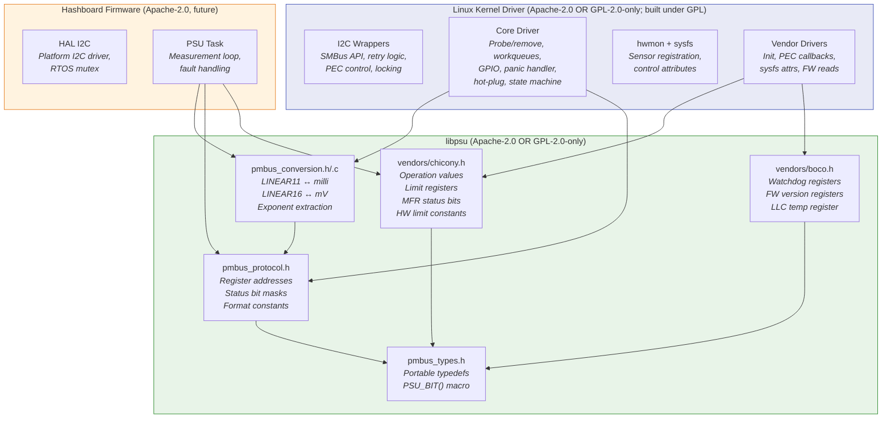
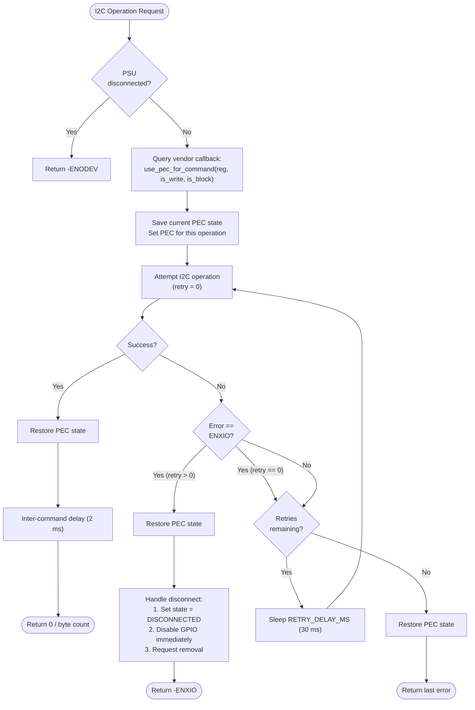
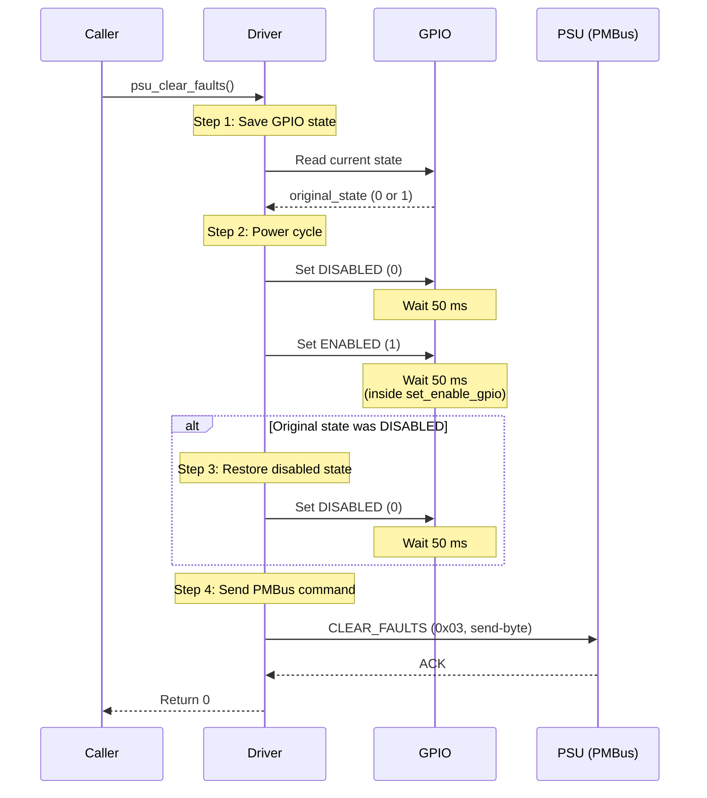
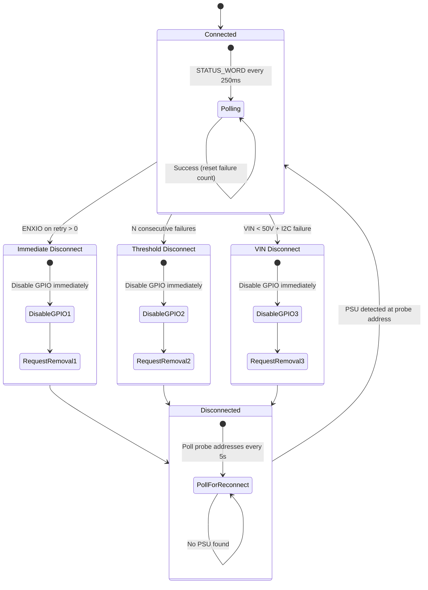
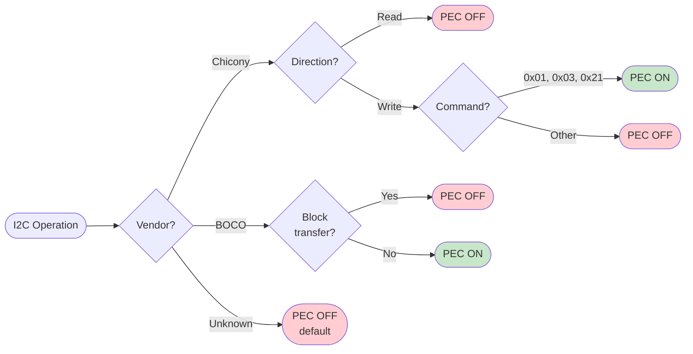

# libpsu Diagrams

## Library Architecture

Shows what libpsu provides (portable) vs what stays platform-specific.

## I2C Retry and PEC Flow

Shows the per-operation retry loop with PEC save/restore.

## Fault Clear GPIO Sequence

Shows the power-cycle sequence required to clear hardware fault latches.

## Disconnect Detection State Machine

Shows the three detection strategies and their interactions.

## PEC Decision Matrix

Shows how PEC is determined per-vendor per-operation.

